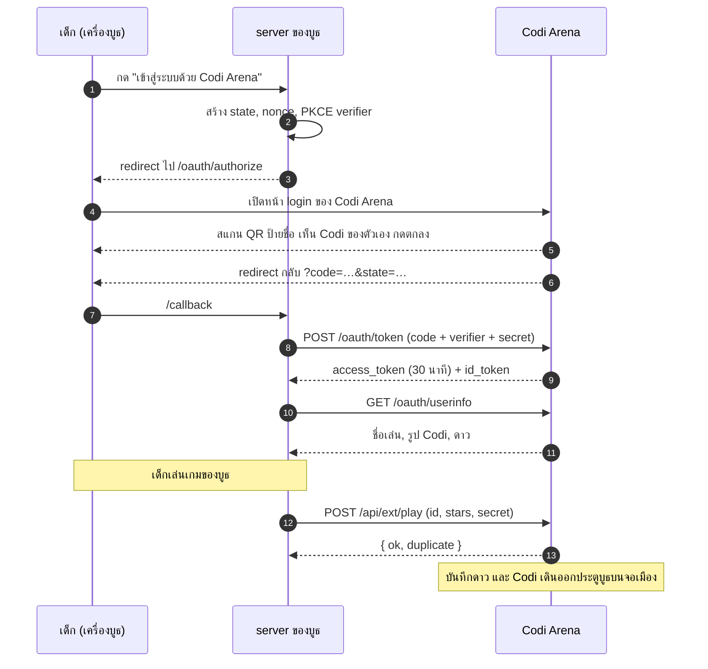

# Login ด้วย Codi Arena: คู่มือสำหรับนักพัฒนา

เอกสารนี้สำหรับทีมที่ทำระบบหน้างานของบูธ (เริ่มจาก CodeVenture) ที่จะให้เด็กเข้าสู่ระบบด้วยป้ายชื่อ Codi Arena ดึงชื่อเล่นกับ Codi ของเด็กมาแสดง แล้วส่งดาวกลับเข้า Codi Arena

hub ของ Codi Arena เป็นผู้ให้บริการ OpenID Connect มาตรฐาน เหมือน "Login with Google" ใช้ library OIDC ที่มีอยู่ได้เลย

## เริ่มต้น

1. ขอลิงก์เชิญจากผู้ดูแล Codi Arena เปิดลิงก์แล้วตั้งชื่อกับรหัสผ่าน จะเข้า **Codi Arena for Developers** (`<issuer>/developers`)
2. แท็บ **App ของทีม** กด "สร้าง app" ใส่ชื่อ บูธเกมที่จะส่งดาว และ redirect URI จะได้ `client_id` และ `client_secret` (secret แสดงครั้งเดียว)
3. app ใหม่อยู่ใน **โหมดทดสอบ**: เข้าสู่ระบบได้เฉพาะ **ป้ายทดสอบ** (แท็บป้ายทดสอบ สแกน QR จากจอหรือพิมพ์รหัส) ดาวที่ส่งไม่ขึ้นงานจริง
4. พร้อมแล้ว ไปที่ตั้งค่า app แท็บ **เปิดใช้จริง** เลือกบูธเกม แล้วส่งคำขอ ผู้ดูแลอนุมัติแล้ว app เป็น **โหมดจริง**: เด็กทุกคนเข้าสู่ระบบได้ ใช้ `client_id` และ secret เดิม

| | โหมดทดสอบ | โหมดจริง |
|---|---|---|
| เข้าสู่ระบบได้ | ป้ายทดสอบเท่านั้น | ป้ายจริงและป้ายทดสอบ |
| redirect URI | https หรือ `http://localhost` (ทุก port) | https เท่านั้น |
| ดาว | บันทึกให้ป้ายทดสอบ ไม่ขึ้นจอเมืองหรือสถิติ | ให้บูธที่ผู้ดูแลอนุมัติ |
| วันงาน | ผู้ดูแลอาจปิดโหมดทดสอบทั้งหมด (`/login?error=test_off`) | ใช้ได้ตามปกติ |

- issuer คือ `<issuer>` (discovery: `<issuer>/.well-known/openid-configuration`)
- เก็บ `client_secret` ไว้บน server เท่านั้น ห้ามใส่ในหน้าเว็บหรือแอปบนเครื่องบูธ ถ้าหลุด ไปที่แท็บ **กุญแจ** กด "ออก secret ใหม่" secret เดิมและ token เดิมจะใช้ไม่ได้ทันที
- ทุกคนในทีมเห็นและจัดการ app ของทีมได้
- แท็บ **เอกสาร API** ของ Portal มีปุ่ม "ลองเลย" ลอง login ด้วยป้ายทดสอบแล้วดู token กับ userinfo ที่ app ได้รับ
- **เครื่องที่บูธ (MacBook หรือ notebook) ใช้กล้องหน้าในตัว** สแกน QR บนป้ายชื่อที่ได้จากจุดลงทะเบียน
- อ่านต่อ: **คู่มือ Developer Portal** (ในเมนูเอกสาร และ PDF), **โค้ดตัวอย่าง** (`example/server.mjs` server ของบูธแบบไฟล์เดียว)

## ลำดับการทำงาน



ทุกครั้งที่เข้าสู่ระบบ เด็กต้องสแกนป้ายใหม่ hub ไม่จำการเข้าสู่ระบบไว้บนเครื่อง เพราะเครื่องบูธใช้ร่วมกันหลายคน `prompt=none` จึงได้ `login_required` เสมอ

## ตั้งค่า

| | ค่า |
|---|---|
| discovery | `<issuer>/.well-known/openid-configuration` |
| response type | `code` เท่านั้น |
| PKCE | บังคับ `S256` |
| client auth | `client_secret_basic` หรือ `client_secret_post` |
| ID token | JWT `RS256` กุญแจที่ `<issuer>/oauth/jwks` |
| access token | อายุ 30 นาที ไม่มี refresh token |
| code | ใช้ได้ครั้งเดียว อายุ 60 วินาที; ใช้ซ้ำ = token จากครั้งแรกถูกยกเลิกด้วย |

## Scope และข้อมูลที่ได้

| scope | claim ใน userinfo |
|---|---|
| `openid` (ต้องมี) | `sub`: รหัสเด็กของแอปคุณเอง คงที่ ไม่ซ้ำกับแอปอื่น ไม่ใช่รหัสป้าย |
| `profile` | `name` และ `nickname` (ชื่อเล่น), `picture` (PNG พื้นโปร่ง เติม `?size=128`, `256` หรือ `512`), `arena_no` (หมายเลขป้าย), `arena_avatar` (ชุด Codi เป็น JSON), `arena_test` (`true` เมื่อเป็นป้ายทดสอบ: อย่าแสดงในตารางหรือจอของงานจริง) |
| `arena.stars` | `arena_stars` (ดาวรวม), `arena_rank` (ระดับ หรือ `null`), `arena_booths` (`[{ id, stars }]`) |
| `arena.play` | สิทธิ์ส่งดาวของบูธที่แอปผูกไว้ ให้เด็กเจ้าของ token เท่านั้น |

แอปไม่ได้ชื่อจริง ข้อมูลผู้ปกครอง หรือข้อมูลติดต่อ ถ้ายังไม่มีรูปของชุดนั้น (เช่น ป้ายทดสอบ หรือเด็กที่แต่งตัวก่อนระบบรูปเปิดใช้) `picture` จะ redirect ไปรูป Codi ของแบรนด์

## ส่งดาว

```http
POST <issuer>/api/ext/play
Authorization: Bearer <access_token>
Content-Type: application/json

{ "id": "run-2026-10-20-0042", "stars": 2, "secret": false }
```

- `id`: รหัสรอบเล่นของคุณ 1-64 ตัว (`A-Z a-z 0-9 . _ : -`) ส่งซ้ำด้วย `id` เดิมได้ ไม่บันทึกซ้ำ (คืน `"duplicate": true`) จึงลองส่งใหม่ได้ปลอดภัยเมื่อเน็ตหลุด
- `stars`: จำนวนเต็ม 0-3 hub เก็บดาวสูงสุดของเด็กต่อบูธ
- `secret`: `true` เมื่อเด็กทำภารกิจลับของบูธคุณสำเร็จ
- ตอบ `{ "ok": true, "duplicate": false }`

## Error

| ที่ไหน | error | เมื่อ |
|---|---|---|
| authorize (redirect กลับพร้อม `error`) | `invalid_scope` | ขอ scope ที่แอปไม่ได้ลงทะเบียน หรือไม่มี `openid` |
| | `invalid_request` | ไม่มี PKCE `S256` |
| | `login_required` | ส่ง `prompt=none` |
| | `access_denied` | เด็กกด "ไม่ให้" |
| authorize (ไม่ redirect, แสดงหน้าข้อผิดพลาดของ hub) | | `client_id` ไม่รู้จัก, `redirect_uri` ไม่ได้ลงทะเบียน หรือโหมดทดสอบถูกปิด |
| หน้า login | | app โหมดทดสอบ + ป้ายจริง: "ใช้ได้เฉพาะป้ายทดสอบ" |
| token | `invalid_client` (401) | `client_id` / secret ผิด หรือแอปถูกหยุด |
| | `invalid_grant` (400) | code ผิด ใช้แล้ว หมดอายุ `redirect_uri` ไม่ตรง หรือ PKCE verifier ไม่ตรง |
| userinfo, play | `invalid_token` (401) | token หมดอายุ ถูกยกเลิก หรือแอปถูกหยุด: ให้เด็กเข้าสู่ระบบใหม่ |
| play | `insufficient_scope` (403) | token ไม่มี `arena.play` |
| | `invalid_request` (400) | `id`, `stars` หรือ `secret` ผิดรูปแบบ |
| ทุกที่ | `slow_down` (429) | เกิน 120 ครั้ง/นาทีต่อแอป (หน้า login: 30 ครั้ง/นาทีต่อเครื่อง) |

## เมื่อ hub ใช้ไม่ได้

ตั้ง timeout ไว้ 5 วินาที ถ้าเข้าสู่ระบบไม่ได้ ให้เด็กเล่นต่อแบบไม่ได้ดาว และขึ้นข้อความว่า "เล่นได้แต่ยังไม่ได้ดาว" ดาวที่ส่งไม่สำเร็จให้เก็บไว้แล้วส่งใหม่ด้วย `id` เดิมจนกว่า token หมดอายุ

## ตัวอย่าง: Node.js กับ `openid-client` (v6)

```js
import * as client from 'openid-client'

const config = await client.discovery(new URL(process.env.CODI_ISSUER), process.env.CODI_CLIENT_ID, process.env.CODI_CLIENT_SECRET)

// 1. ปุ่ม "เข้าสู่ระบบด้วย Codi Arena": เก็บ verifier, state, nonce ใน session ของเครื่องนั้น
const verifier = client.randomPKCECodeVerifier(), state = client.randomState(), nonce = client.randomNonce()
const url = client.buildAuthorizationUrl(config, {
  redirect_uri: 'https://booth.example/callback', scope: 'openid profile arena.stars arena.play',
  code_challenge: await client.calculatePKCECodeChallenge(verifier), code_challenge_method: 'S256', state, nonce,
})
// res.redirect(url.href)

// 2. ที่ /callback
const tokens = await client.authorizationCodeGrant(config, new URL(req.url, 'https://booth.example'), { pkceCodeVerifier: verifier, expectedState: state, expectedNonce: nonce })
const kid = await client.fetchUserInfo(config, tokens.access_token, tokens.claims().sub)
// kid.nickname, kid.picture + '?size=256', kid.arena_stars

// 3. เล่นจบ
await fetch(new URL('/api/ext/play', process.env.CODI_ISSUER), {
  method: 'POST', headers: { authorization: `Bearer ${tokens.access_token}`, 'content-type': 'application/json' },
  body: JSON.stringify({ id: runId, stars: 2, secret: false }),
})
```

ถ้าต่อกับ hub ที่รันบนเครื่องตัวเอง (`http://localhost:8787`) ให้เพิ่ม `{ execute: [client.allowInsecureRequests] }` ใน `discovery` เฉพาะกรณีนั้น

## ตัวอย่าง: Auth.js (NextAuth) custom provider

```js
{
  id: 'codi-arena', name: 'Codi Arena', type: 'oidc',
  issuer: process.env.CODI_ISSUER, clientId: process.env.CODI_CLIENT_ID, clientSecret: process.env.CODI_CLIENT_SECRET,
  checks: ['pkce', 'state', 'nonce'],
  authorization: { params: { scope: 'openid profile arena.stars arena.play' } },
  profile: p => ({ id: p.sub, name: p.nickname, image: `${p.picture}?size=256` }),
}
```

## ตัวอย่าง: curl (ขั้นแลก code)

```sh
curl -s -u "$CLIENT_ID:$CLIENT_SECRET" "$ISSUER/oauth/token" \
  -d grant_type=authorization_code -d code="$CODE" -d redirect_uri="$REDIRECT" -d code_verifier="$VERIFIER"
curl -s -H "authorization: Bearer $ACCESS" "$ISSUER/oauth/userinfo"
```

## API อ้างอิง

`openapi.yaml` ในโฟลเดอร์นี้ (token, userinfo, play)
